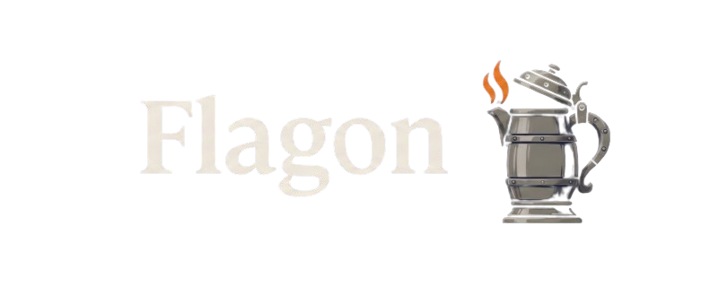

<div align="center">
  
<p>
    <a href="#quickstart">Quickstart</a> &nbsp;•&nbsp;
    <a href="docs/COMPATIBILITY.md">Compatibility</a> &nbsp;•&nbsp;
    <a href="docs/DOWNSTREAM.md">Packaging</a> &nbsp;•&nbsp;
    <a href="docs/ARCHITECTURE.md">Architecture</a>
  </p>

[](https://teavm.org)
[](https://bun.sh)
[](https://openjdk.org/)
[](LICENSE)
</div>

##
Flagon compiles desktop Java bytecode into browser-native WebAssembly GC and JavaScript using TeaVM, reimplementing LWJGL 2 & 3, OpenGL, OpenAL, OPFS filesystem persistence, and socket networking over browser APIs.

## Status

Try the demos and the Java playground at [flagon-nu.vercel.app](https://flagon-nu.vercel.app). The playground compiles with javac and TeaVM in the browser; build it with `make playground`.

Current target is Minecraft 1.8.9, currently loads singleplayer worlds in Chromium.

>[!IMPORTANT]
>Flagon is not affiliated with or endorsed by Mojang Studios or Microsoft. It does not distribute Minecraft or any proprietary third-party content. Users must independently supply their own JAR files and assets, and are responsible for ensuring they have the necessary rights to use them. Flagon is not intended to facilitate software piracy or copyright infringement.

**Future**:
- Speed up startup (especially [Firefox](https://github.com/KingJayan/flagon/issues/546)) and optimize bundle size
- Native modded minecraft(packaged into bundle, FabricMC)
- Equal functionality across 1.8.9, 1.12.x, 1.20.x, and modern versions
- Flagon CLI on Homebrew/MacPorts
- WebGPU renderer
- Native C->Executable backend

## Quickstart

Requires **JDK 25+** and **[Bun](https://bun.sh)**.

```bash
make setup   # Install dependencies
make build   # Compile and output bundles
make dev     # Start dev server at http://127.0.0.1:5273
```

To test a standalone JAR without setup, drop it into `vendor/` and run `make app` (see [Running an Existing JAR](DOWNSTREAM.md#quickstart-no-setup)).

>[!NOTE]
>**Networking (`make serve`):** host static build with the WSS-to-TCP bridge (see [Networking Details](COMPATIBILITY.md)).

## Testing

```bash
make test      # JVM unit tests
make browser   # Playwright tests (Chromium & Firefox on both backends)
make check     # Full CI run
```

## Comparison

| Project | Target Input | Graphics Pipeline | Sockets & Filesystem | License |
| --- | --- | --- | --- | --- |
| **Flagon** | Unmodified JAR | Reimplemented on WebGL2 (LWJGL 2 & 3) | OPFS persistence + Proxied TCP | MIT |
| **TeaVM** | Source / Bytecode | None (core classlib only) | In-memory only | Apache 2.0 |
| **CheerpJ** | Unmodified JAR | JVM virtualization (no desktop LWJGL) | Emulated virtual FS | Proprietary |
| **Eaglercraft** | Forked 1.8/1.12 Source | Custom WebGL port (Minecraft only) | IndexedDB / Local | Contested |

## License

Licensed under [MIT](https://github.com/KingJayan/flagon/blob/main/LICENSE).
