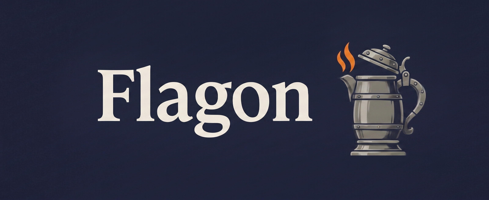

<div align="center">
  

  <h1>Flagon</h1>

  <p><strong>Run unmodified desktop Java/LWJGL applications directly in the browser.</strong></p>

  <a href="https://teavm.org"></a>
  <a href="https://bun.sh"></a>
  <a href="https://openjdk.org/"></a>
</div>

<br />


## What is Flagon?

Flagon lets existing desktop Java/LWJGL applications run directly in the browser,
without modifying application code.

It achieves this by reimplementing the desktop APIs that applications already compile
against (`Display`, `GL11`, `Keyboard`, `Mouse`, `BufferUtils`, etc.) on top of
WebGL2, DOM events, and browser APIs.

Flagon itself is application-agnostic. Work on any particular application lives downstream;
[flagon-mc](https://github.com/KingJayan/flagon-mc) is one such target.

## Features

- Run existing desktop Java/LWJGL applications directly in the browser
- No application source modifications required
- Ahead-of-time Java → JavaScript compilation with TeaVM (WASM-GC support is WIP)
- WebGL2 implementation of core LWJGL APIs
- Browser-native implementations of input, filesystem, audio, networking, and platform APIs
- Application-agnostic architecture for downstream projects

## Documentation

* **[Architecture Guidelines (for contributing)](docs/ARCHITECTURE.md):** Layering rules and system design.
* **[Compatibility Matrix](docs/COMPATIBILITY.md):** Detailed breakdown of supported and unsupported features.
* **[Running Existing Applications](docs/DOWNSTREAM.md):** Compiling an application jar to a bundle.

## Roadmap for WASM-GC Support

Flagon compiles to JS today. TeaVM can also target WebAssembly GC, which keeps Java objects
in the WebAssembly heap and hands garbage collection to the engine. These are the stages to running
every bundle on it.

| Stage | Status |
| :--- | :--- |
| Toolchain able to emit WASM GC | `✔` |
| Bundles compile and boot in the browser | `✔` |
| Graphics and input | `✔` |
| Files, audio, and networking | `✔` |
| Browser suite green on both backends | `✔` |
| WASM GC as the default backend | `⧖` |

## Quickstart

Requires **JDK 17+** and **[bun](https://bun.sh)**. Maven is provided via the wrapper.

```sh
# compiles java and emits the browser bundle
./mvnw package

# initialize and run the development server
cd web && bun install && bun run dev
```
Once running, open <http://localhost:5273>. Select a bundle, a backend, and a program, and run it.
`./mvnw -Pwasm package` emits the same bundles compiled to WebAssembly GC, which the `wasm` backend
runs.
The `example` bundle contains [an unmodified LWJGL application](example-app/).
The `sandbox` bundle contains diagnostics and regression programs.


> [!NOTE]
> Appending ?program=selftest to the URL runs the compilation-backend regression suite.

## Testing

Flagon includes both JVM unit tests and browser-level integration tests.

```sh
# jvm unit tests
./mvnw test                     

# browser tests against the real bundle
cd web && bunx playwright test
```

## License

Licensed under the MIT License. See [LICENSE](LICENSE) for details.