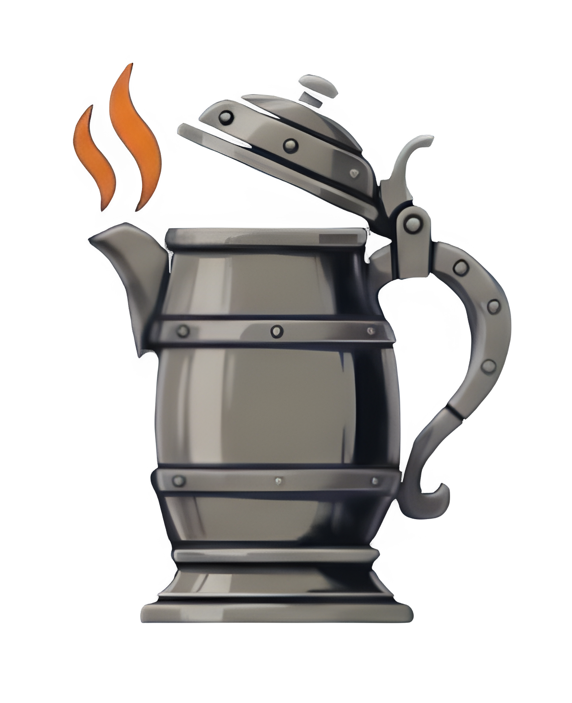

<div align="center">
  <br />
  

  <h1>Flagon</h1>

  <p><strong>Run unmodified desktop Java & LWJGL applications directly in the browser.</strong></p>

  <p>
    <a href="#quickstart">Quickstart</a> &nbsp;•&nbsp;
    <a href="docs/COMPATIBILITY.md">Compatibility</a> &nbsp;•&nbsp;
    <a href="docs/DOWNSTREAM.md">Packaging</a> &nbsp;•&nbsp;
    <a href="docs/ARCHITECTURE.md">Architecture</a>
  </p>

  <svg height="3" width="320" style="display: block; margin: 12px 0 18px 0;">
    <defs>
      <linearGradient id="flagonGlow" x1="0%" y1="0%" x2="100%" y2="0%">
        <stop offset="0%" stop-color="#4c566a" stop-opacity="0" />
        <stop offset="30%" stop-color="#d08770" />
        <stop offset="50%" stop-color="#ebcb8b" />
        <stop offset="70%" stop-color="#d08770" />
        <stop offset="100%" stop-color="#4c566a" stop-opacity="0" />
      </linearGradient>
    </defs>
    <rect width="320" height="3" rx="1.5" fill="url(#flagonGlow)" />
  </svg>

  <p>
    <a href="https://teavm.org"></a>
    <a href="https://bun.sh"></a>
    <a href="https://openjdk.org/"></a>
    <a href="LICENSE"></a>
  </p>
</div>

<br />

Flagon compiles desktop Java bytecode into browser-native WebAssembly GC and JavaScript using TeaVM, reimplementing LWJGL 2 & 3, OpenGL, OpenAL, OPFS filesystem persistence, and socket networking over browser APIs.

<br />

Flagon compiles desktop Java bytecode into browser-native WebAssembly GC and JavaScript using TeaVM, reimplementing LWJGL 2 & 3, OpenGL, OpenAL, OPFS filesystem persistence, and socket networking over browser APIs.

## Documentation

* **[Compatibility Reference](docs/COMPATIBILITY.md):** Complete support map for JDK, LWJGL, OpenGL, audio, and networking APIs.
* **[Packaging Downstream Apps](docs/DOWNSTREAM.md):** Step-by-step guide for bundling existing applications or setting up Maven modules.
* **[Architecture Guidelines](docs/ARCHITECTURE.md):** Internal design, repo layout, and contributor rules.

## Quickstart

Requires **JDK 25+** and **[Bun](https://bun.sh)**.

```sh
make setup   # Install dependencies
make build   # Compile Java and emit WASM GC / JS bundles
make dev     # Start development server at http://localhost:5273
```

To test a standalone JAR immediately without setup, drop it into `vendor/` and run `make app` (see [Running an Existing JAR](https://www.google.com/search?q=docs/DOWNSTREAM.md%23quick-test-no-project-setup)).

* **Developer Shell (`/`):** Console, runtime diagnostics, and program picker.
* **Fullscreen View (`/play/?bundle=app`):** Edge-to-edge canvas execution.
* **Networking (`make serve`):** Hosts the static build alongside the required WebSocket-to-TCP bridge (see [Networking Details](https://www.google.com/search?q=docs/COMPATIBILITY.md%23networking-javanet)).

## Testing

```sh
make test      # JVM unit tests
make browser   # Playwright integration tests (Chromium & Firefox across both backends)
make check     # Full CI verification suite
```

## Comparison

| Project | Target Input | Graphics Pipeline | Sockets & Filesystem | License |
| --- | --- | --- | --- | --- |
| **Flagon** | Unmodified JAR | Reimplemented on WebGL2 (LWJGL 2 & 3) | OPFS persistence + Proxied TCP | MIT |
| **TeaVM** | Source / Bytecode | None (core classlib only) | In-memory only | Apache 2.0 |
| **CheerpJ** | Unmodified JAR | JVM virtualization (no desktop LWJGL) | Emulated virtual FS | Proprietary |
| **Eaglercraft** | Forked 1.8 Source | Custom WebGL port (Minecraft only) | IndexedDB / Local | Contested |

## License

Licensed under the MIT License. See [LICENSE](https://www.google.com/search?q=LICENSE) for details.
